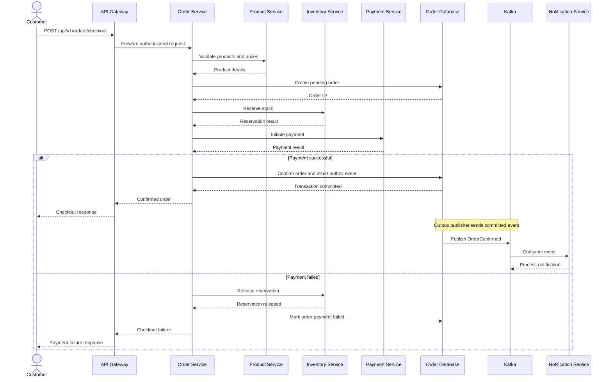
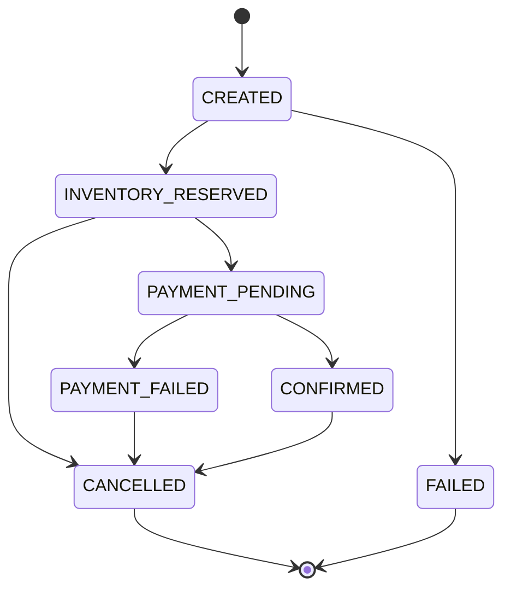
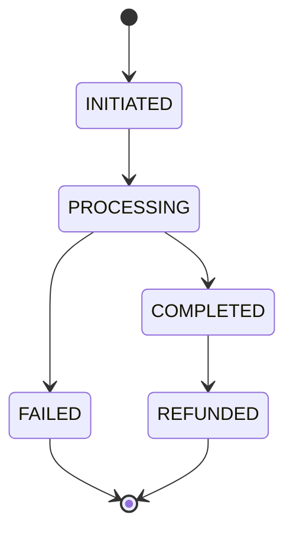
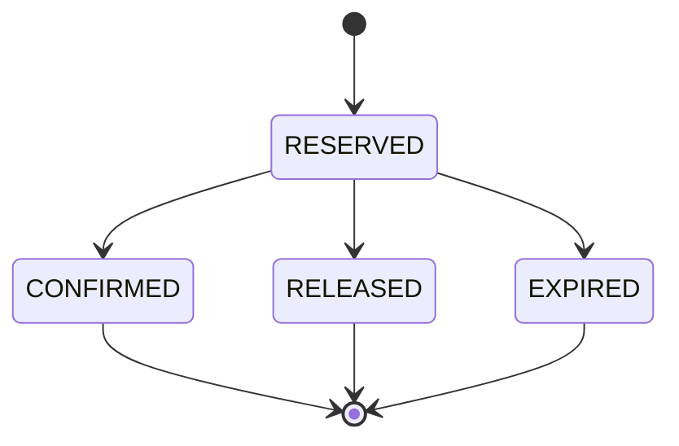

# Checkout Sequence and State Transitions

## 1. Purpose

This document defines the detailed checkout sequence and order state transitions.

Checkout is the most important business workflow because it coordinates Product, Inventory, Order, and Payment services.

## 2. Checkout Sequence Diagram

## 3. Checkout Processing Steps

### Step 1: Receive Checkout Request

Order Service receives the checkout request through API Gateway.

It validates:

- Customer identity.
- Product identifiers.
- Requested quantities.
- Idempotency key.
- Shipping information.

### Step 2: Validate Products

Order Service calls Product Service.

Product Service verifies:

- Product exists.
- Product is active.
- Current price.
- Currency.

Order Service calculates the final order amount using server-side product information, not a price supplied by the client.

### Step 3: Create Pending Order

Order Service creates an order with an initial state.

The order and order items are saved within one local database transaction.

### Step 4: Reserve Inventory

Order Service calls Inventory Service.

Inventory Service:

1. Checks available quantity.
2. Updates stock safely.
3. Creates a reservation.
4. Returns the reservation identifier.

If reservation fails, checkout stops and the order is marked as failed or cancelled according to the agreed state model.

### Step 5: Process Payment

Order Service calls Payment Service.

Payment Service:

1. Validates payment request.
2. Checks idempotency key.
3. Invokes mock payment provider.
4. Records payment result.
5. Returns the result.

### Step 6: Confirm or Compensate

If payment succeeds:

- Confirm the inventory reservation.
- Confirm the order.
- Insert OrderConfirmed into the outbox in the same Order Service database transaction.
- Return the confirmed order response.

If payment fails:

- Release the inventory reservation.
- Mark the order as PAYMENT_FAILED.
- Return an appropriate failure response.

If a downstream operation times out and its result is unknown, do not assume failure or blindly repeat the operation. Reconcile using the operation identifier or idempotency key.

### Step 7: Publish Business Event

The OutboxPublisher reads committed, unpublished records and publishes them to Kafka.

Notification and Analytics services consume the event independently.

## 4. Order State Machine

The diagram shows the main business states. The actual implementation must validate transitions and include any additional intermediate states required for timeout reconciliation.

## 5. Order Status Definitions

| Status | Description |
|---|---|
| CREATED | Order has been created |
| INVENTORY_RESERVED | Stock has been reserved |
| PAYMENT_PENDING | Payment is being processed |
| CONFIRMED | Payment succeeded and order is confirmed |
| PAYMENT_FAILED | Payment failed |
| CANCELLED | Order was cancelled |
| FAILED | Checkout could not proceed |

## 6. Payment State Machine

Payment Service owns payment state transitions.

A refund is a separate business operation and must not simply overwrite the original payment history.

## 7. Inventory Reservation State Machine

Reservation release and expiry must be idempotent.

## 8. Idempotency Rules

| Operation | Idempotency Mechanism |
|---|---|
| Checkout | Client-supplied idempotency key |
| Payment initiation | Payment idempotency key |
| Inventory reservation | Order or reservation identifier |
| Inventory release | Reservation identifier |
| Kafka processing | Event ID |

Repeated requests must not create duplicate payments, reservations, or orders.

## 9. Transaction Boundaries

The platform uses local transactions within each service.

Examples:

- Order and order items are saved in one Order Service transaction.
- Inventory changes and reservation creation are handled in one Inventory Service transaction.
- Payment records are saved within Payment Service transactions.
- Order confirmation and outbox insertion are committed together.

There is no distributed ACID transaction across all services.

## 10. Failure Scenarios

| Scenario | Expected Action |
|---|---|
| Product unavailable | Stop checkout |
| Insufficient stock | Do not initiate payment |
| Inventory timeout | Reconcile reservation outcome |
| Payment declined | Release inventory and mark payment failed |
| Payment timeout | Reconcile payment outcome before retry |
| Kafka unavailable | Keep outbox event pending |
| Duplicate event | Ignore already-processed event |
| Notification failure | Retry independently |
| Analytics failure | Retry independently without blocking checkout |

## 11. Conclusion

The checkout workflow uses Order Service as the Saga orchestrator.

The workflow combines synchronous REST calls for immediate business decisions, local database transactions for service-owned data, and Kafka events for asynchronous processing.

The state machines, idempotency rules, and compensation actions provide the detailed implementation foundation for reliable checkout.