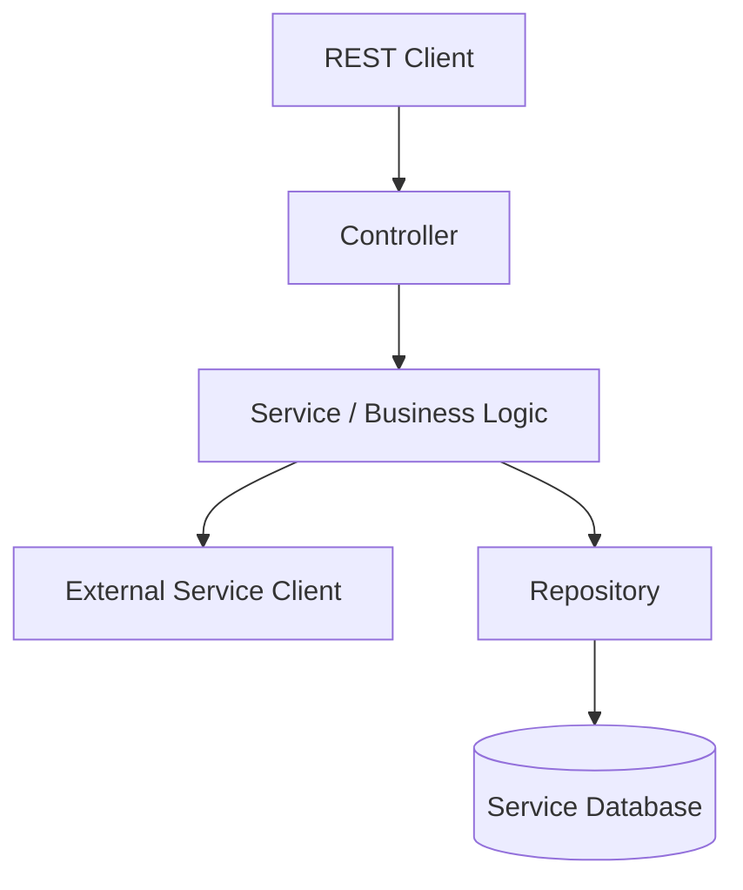

# Class Design and Responsibilities

## 1. Purpose

This document defines the main Java classes, their responsibilities, and the interactions between application layers.

The design uses Spring Boot, Spring WebFlux, Project Reactor, and dependency injection.

## 2. Common Layer Architecture



## 3. API Gateway

| Class | Responsibility |
|---|---|
| GatewayApplication | Application entry point |
| SecurityGatewayFilter | JWT validation and request security |
| CorrelationIdFilter | Correlation ID propagation |
| RateLimitConfiguration | Rate-limiting configuration |
| RouteConfiguration | Service route definitions |

Spring Cloud Gateway filters will handle cross-cutting request concerns. Business authorization remains enforced in the relevant services.

## 4. Auth Service

| Class | Responsibility |
|---|---|
| AuthController | Registration, login, and refresh endpoints |
| AuthService | Authentication business logic |
| UserService | User management |
| UserRepository | User persistence |
| RoleRepository | Role persistence |
| RefreshTokenRepository | Refresh token persistence |
| JwtService | JWT creation and validation |
| PasswordService | Password hashing and verification |
| User | User entity |
| Role | Role entity |
| RefreshToken | Refresh token entity |
| RegisterRequest | Registration request DTO |
| LoginRequest | Login request DTO |
| AuthResponse | Token response DTO |

### Main method responsibilities

- `register(RegisterRequest)` — validates and creates a user.
- `login(LoginRequest)` — authenticates a user and issues tokens.
- `refreshToken(String)` — validates a refresh token and issues a new access token.
- `revokeRefreshToken(String)` — revokes a refresh token.

## 5. Product Service

| Class | Responsibility |
|---|---|
| ProductController | Product REST endpoints |
| CategoryController | Category REST endpoints |
| ProductService | Product business logic |
| CategoryService | Category business logic |
| ProductRepository | Product database access |
| CategoryRepository | Category database access |
| ProductCacheService | Redis cache operations |
| ProductMapper | Entity and DTO conversion |
| Product | Product entity |
| Category | Category entity |
| CreateProductRequest | Product creation DTO |
| UpdateProductRequest | Product update DTO |
| ProductResponse | Product response DTO |

### Main methods

- `createProduct(CreateProductRequest)`
- `getProductById(UUID)`
- `getProducts(PageRequest)`
- `updateProduct(UUID, UpdateProductRequest)`
- `deactivateProduct(UUID)`

Product updates must invalidate or refresh the associated Redis cache entry.

## 6. Cart Service

| Class | Responsibility |
|---|---|
| CartController | Cart REST endpoints |
| CartService | Cart business logic |
| CartRepository | Redis cart persistence |
| ProductClient | Product Service communication |
| CartItem | Cart item model |
| Cart | Cart model |
| AddCartItemRequest | Add-item request |
| UpdateCartItemRequest | Update-item request |
| CartResponse | Cart response |

### Main methods

- `getCart(UUID)`
- `addItem(UUID, AddCartItemRequest)`
- `updateItem(UUID, UUID, UpdateCartItemRequest)`
- `removeItem(UUID, UUID)`
- `clearCart(UUID)`

Cart Service stores product IDs and quantities. Product prices and stock are revalidated during checkout.

## 7. Inventory Service

| Class | Responsibility |
|---|---|
| InventoryController | Inventory REST endpoints |
| InventoryService | Stock and reservation business logic |
| InventoryRepository | Inventory database access |
| ReservationRepository | Reservation database access |
| ReservationScheduler | Expired reservation cleanup |
| Inventory | Inventory entity |
| InventoryReservation | Reservation entity |
| ReserveStockRequest | Reservation request |
| ReservationResponse | Reservation response |

### Main methods

- `getStock(UUID)`
- `reserveStock(ReserveStockRequest)`
- `confirmReservation(UUID)`
- `releaseReservation(UUID)`
- `releaseExpiredReservations()`

Stock updates and reservation creation must be atomic within the Inventory Service database.

## 8. Order Service

| Class | Responsibility |
|---|---|
| OrderController | Order REST endpoints |
| CheckoutService | Checkout orchestration |
| OrderService | Order lifecycle management |
| OrderRepository | Order persistence |
| OrderItemRepository | Order item persistence |
| ProductClient | Product Service communication |
| InventoryClient | Inventory Service communication |
| PaymentClient | Payment Service communication |
| SagaOrchestrator | Checkout state coordination |
| OutboxRepository | Outbox persistence |
| OutboxPublisher | Outbox event publication |
| Order | Order entity |
| OrderItem | Order item entity |
| OutboxEvent | Outbox entity |
| CheckoutRequest | Checkout request DTO |
| OrderResponse | Order response DTO |

### Main methods

- `checkout(UUID, CheckoutRequest)`
- `getOrderById(UUID, UUID)`
- `getCustomerOrders(UUID)`
- `cancelOrder(UUID, UUID)`
- `confirmOrder(UUID)`
- `markPaymentFailed(UUID)`

The CheckoutService coordinates Product, Inventory, and Payment operations.

The SagaOrchestrator tracks the progress of the workflow and determines which compensation actions are required.

The OutboxPublisher publishes important business events after their database transactions have committed.

## 9. Payment Service

| Class | Responsibility |
|---|---|
| PaymentController | Payment REST endpoints |
| PaymentService | Payment business logic |
| PaymentRepository | Payment persistence |
| PaymentProvider | Provider abstraction |
| MockPaymentProvider | Simulated payment processing |
| PaymentEventPublisher | Payment event publishing |
| Payment | Payment entity |
| PaymentRequest | Payment request DTO |
| PaymentResponse | Payment response DTO |

### Main methods

- `processPayment(PaymentRequest)`
- `getPaymentByOrderId(UUID)`
- `refundPayment(UUID)`
- `getPaymentStatus(UUID)`

The mock provider simulates successful, failed, and delayed payment results.

## 10. Notification Service

| Class | Responsibility |
|---|---|
| NotificationConsumer | Kafka event listener |
| NotificationHandler | Event processing |
| NotificationService | Notification business logic |
| NotificationRepository | Notification persistence |
| Notification | Notification entity |
| NotificationDelivery | Delivery abstraction |

### Main methods

- `handleOrderEvent(OrderEvent)`
- `handlePaymentEvent(PaymentEvent)`
- `sendNotification(Notification)`

The first version logs notification content instead of sending real emails or SMS messages.

## 11. Analytics Service

| Class | Responsibility |
|---|---|
| AnalyticsConsumer | Kafka event listener |
| AnalyticsService | Event aggregation |
| AnalyticsRepository | Reporting data persistence |
| OrderSummary | Order summary model |
| DailySalesSummary | Daily sales model |

### Main methods

- `handleOrderEvent(OrderEvent)`
- `handlePaymentEvent(PaymentEvent)`
- `getDailySales(LocalDate)`
- `getOrderStatistics()`

Analytics processing must not block customer-facing checkout operations.

## 12. Reactive Method Design

Example service method:

```java
public Mono<ProductResponse> getProductById(UUID productId) {
    return productRepository.findById(productId)
            .switchIfEmpty(Mono.error(
                    new ProductNotFoundException(productId)
            ))
            .map(productMapper::toResponse);
}
```

Example controller:

```java
@GetMapping("/{id}")
public Mono<ResponseEntity<ProductResponse>> getProduct(
        @PathVariable UUID id) {

    return productService.getProductById(id)
            .map(ResponseEntity::ok);
}
```

These examples illustrate the expected reactive style. Actual implementation may add caching, authorization, and error handling.

## 13. Dependency Injection

Use constructor injection for dependencies.

Avoid field injection.

Business services should depend on interfaces or dedicated components where doing so improves testability.

## 14. Conclusion

The class design establishes clear responsibilities for controllers, services, repositories, external clients, entities, and DTOs.

Each microservice maintains its own business logic and persistence, supporting independent development and testing.